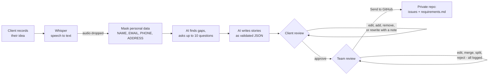

# AI Human Hub


**Live demo:** https://ai-human-hub.vercel.app · **API health:** https://ai-human-hub-api.onrender.com/api/health/
_The API runs on a free instance that sleeps when idle; the first request can take up to a minute._

Clients often struggle to explain what they want built, and developers lose days
chasing missing details. **AI Human Hub** lets a client describe their project by
voice. An AI interviewer finds the gaps and asks follow-up questions, then drafts
user stories with acceptance criteria and priorities. **Nothing reaches the
development team until people have approved it**: first the client, then our
team. Approved stories land in a private GitHub repository as issues.

## How it works



1. **Record:** the client explains their idea in the browser. Audio is held in
   memory only for transcription and never stored.
2. **Mask:** names, emails, phone numbers and addresses become `[NAME]`,
   `[EMAIL]`, `[PHONE]` and `[ADDRESS]` before any text reaches an AI model.
   The client can see exactly what the AI will see.
3. **Interview:** the AI checks the masked transcript against a checklist (users,
   roles, features, data, payments, login, deadlines) and asks up to 10 questions,
   one at a time. The client answers by voice, by text, or with "Not sure".
4. **Draft:** the AI writes user stories ("As a…, I want to…, so that…") with
   acceptance criteria and a Must / Should / Nice-to-have priority.
5. **Client review:** the client edits, removes or adds stories, or asks the AI
   to rewrite them with a note, then approves. Approved stories are locked.
6. **Team review:** an admin edits, merges, splits or rejects stories. Every
   change is recorded with who made it, when, and the wording before and after.
7. **Send to GitHub:** each story becomes an issue with its acceptance criteria
   as a checklist and a priority label, and `requirements.md` is committed.

## Responsible AI

- **Human in the loop:** AI drafts; people decide. Two approvals stand between
  the AI and the development team.
- **AI output is never trusted blindly:** every answer is validated against a
  strict schema (Pydantic). An invalid answer is retried once, then the backup
  provider is used; bad output can never reach the database.
- **Privacy by design:** audio is never stored, and the AI only ever receives
  masked text, including the client's own edits and notes. Our team also sees
  only the masked version.
- **Prompt-injection guard:** client text is passed as data inside tags, the
  prompt says to ignore instructions in it, and the output schema limits what
  an injected instruction could produce.
- **Resilience:** Cloudflare Workers AI is the primary model provider and Groq
  the backup. Switches are logged without client content.
- **Measured quality:** the team dashboard shows how many AI stories were
  approved unchanged versus edited, merged, split or rejected, and how much
  of each provider's free daily quota has been used.

## Security

- Every API request is authenticated with a verified Clerk session token.
- Clients only ever see their own projects; anything else returns 404, so a
  project's existence is never revealed. Admin endpoints check a role stored in
  our own database.
- A one-way status workflow (`interviewing → awaiting client → awaiting admin →
  sent to GitHub`) is enforced on the server: an action outside its stage gets
  409 Conflict.
- GitHub access uses a GitHub App, never a personal token. Each push gets a
  token limited to one **private** repository and to issues and contents, and
  it expires within an hour. Public repositories are refused.
- Clients can delete a project themselves; everything in it goes at once,
  and only a content-free record of the deletion is kept. Projects are
  deleted automatically 12 months after delivery.
- Secrets live only in environment variables; CORS allows only our frontend;
  HTTPS and HSTS are enforced; AI calls are rate-limited per user.

## Tech stack

| Layer | Technology |
|---|---|
| Backend and API | Python 3.14, Django 5.2, Django REST Framework |
| Frontend | Next.js 16, React 19, TypeScript, Tailwind CSS 4 |
| Database | PostgreSQL 18 on Neon |
| Authentication | Clerk |
| Speech-to-text | Whisper large-v3-turbo on Cloudflare Workers AI, Groq as backup |
| Language models | Llama 3.3 70B on Workers AI, gpt-oss-120b on Groq as backup |
| GitHub integration | GitHub App (REST API: issues and contents) |
| Hosting | Render (API), Vercel (frontend) |
| Testing and CI | pytest (225 backend tests), ESLint, GitHub Actions with a Postgres service |

## Engineering decisions

Each significant decision is written up as an Architecture Decision Record:

| ADR | Decision |
|---|---|
| [0001](docs/adr/0001-monorepo-and-stack.md) | Monorepo with Django + DRF and Next.js |
| [0002](docs/adr/0002-postgres-on-neon.md) | PostgreSQL on Neon everywhere, including CI |
| [0003](docs/adr/0003-authentication-with-clerk.md) | Authentication with Clerk |
| [0004](docs/adr/0004-hosting-render-and-vercel.md) | Hosting on Render and Vercel |
| [0005](docs/adr/0005-ai-story-generation.md) | Validated JSON and a backup AI provider |
| [0006](docs/adr/0006-project-status-workflow.md) | A one-way status workflow |
| [0007](docs/adr/0007-admin-review.md) | Admin review with least privilege and a change log |
| [0008](docs/adr/0008-github-delivery.md) | GitHub delivery through an App, safe to retry |
| [0009](docs/adr/0009-progress-from-github.md) | Progress from GitHub issues: signed webhook plus a catch-up read |

## Running it locally

You need Python 3.14, Node.js 24, a Neon (or any PostgreSQL) database, a Clerk
application, and at least one AI provider key (Cloudflare Workers AI or Groq).

```bash
git clone https://github.com/mehak-javed/ai-human-hub.git
cd ai-human-hub/backend
python3 -m venv .venv && source .venv/bin/activate
pip install -r requirements-dev.txt
cp .env.example .env          # then fill in the values
python manage.py migrate
python manage.py runserver
```

In a second terminal:

```bash
cd ai-human-hub/frontend
npm install
cp .env.example .env.local    # then fill in the values
npm run dev
```

Open http://localhost:3000. To make yourself an admin after signing in once:

```bash
python manage.py set_role you@example.com admin
```

Run the tests with `pytest` in `backend/`, and `npm run lint` in `frontend/`.
Sending to GitHub needs a GitHub App: see [docs/github-app-setup.md](docs/github-app-setup.md).

## Repository structure

    backend/
      accounts/     users, roles, Clerk authentication
      projects/     interviews, masking, AI, reviews, GitHub delivery
      tests/        pytest suite (no test calls a real AI, Clerk or GitHub)
    frontend/       Next.js client and team pages
    docs/           use cases, ADRs, GitHub App setup

## Roadmap

- [x] Project setup: Django + DRF, Postgres, Clerk, Next.js, CI, deployment
- [x] Voice recording and transcription with a backup provider
- [x] Personal-data masking with unit tests
- [x] AI story generation with JSON validation and provider fallback
- [x] Follow-up questions answered by voice, text or "Not sure"
- [x] Client review and approval
- [x] Team review (edit, merge, split, reject) with a change log
- [x] Send to GitHub: issues and requirements.md
- [x] Team dashboard: overview, AI usage against the free limits (warns at 80%), AI acceptance rate, activity charts
- [x] Privacy: delete my project, Markdown export, 12-month retention clean-up, privacy notice
- [x] Progress: closed GitHub issues show as built for the client and the team (signed webhook + catch-up sync)
- [ ] Weekly database backups and invite-only sign-up

See [docs/use-cases.md](docs/use-cases.md) for the full specification.

## License

[MIT](LICENSE)
